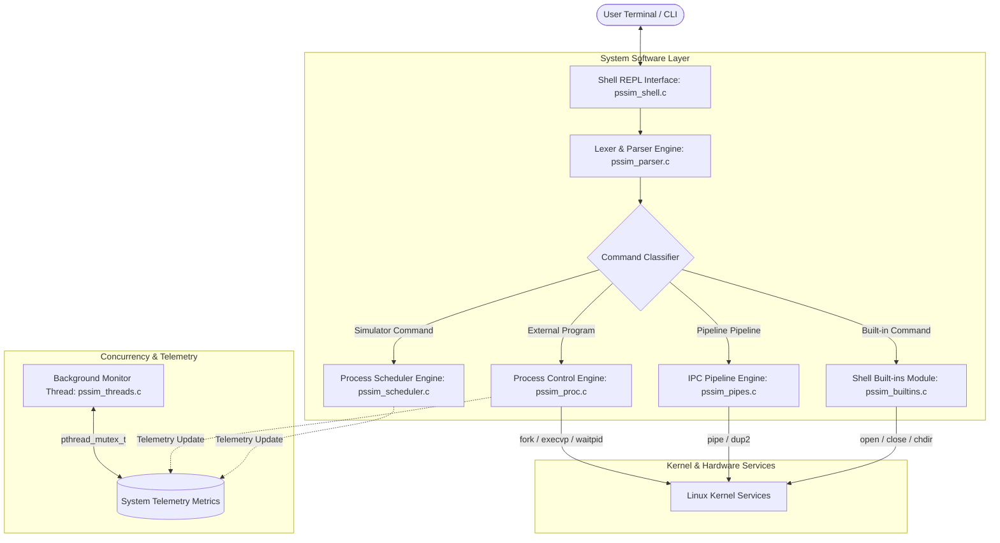
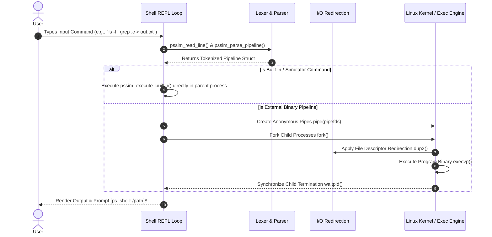
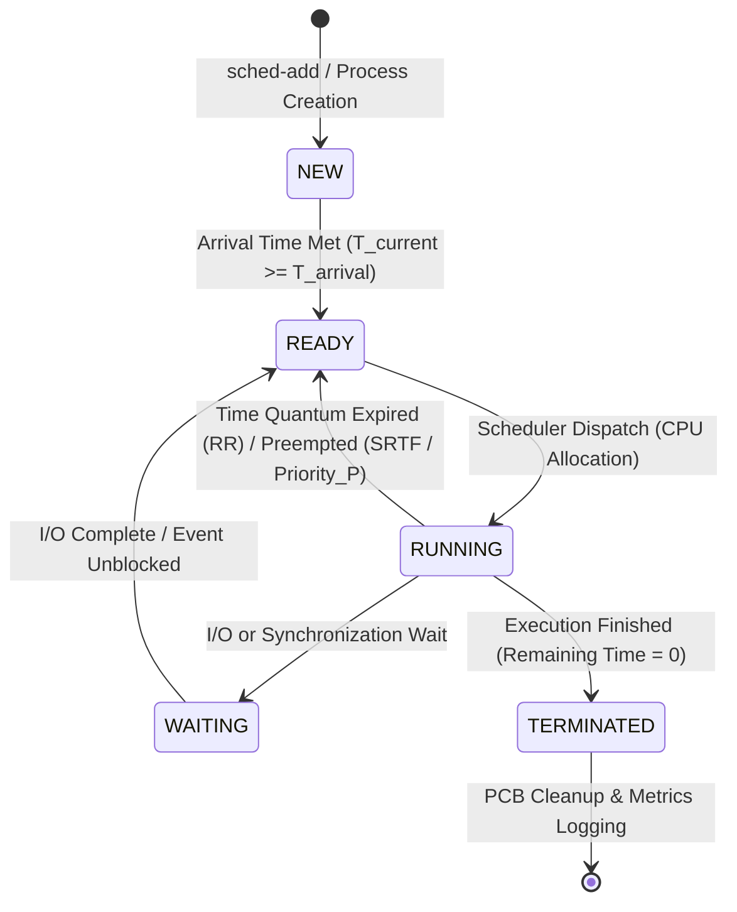

# Process Scheduling Simulator with Shell Interface (PSSIM)

[](https://en.wikipedia.org/wiki/C11_(C_standard_revision))
[]()
[]()
[]()

> **Operating Systems and Systems Programming (OSSP) Project-Based Learning Implementation**  
> A high-performance, modular UNIX Shell combined with an interactive CPU Process Scheduling Simulator engine written in C.

---

## Table of Contents
1. [Project Overview](#project-overview)
2. [Key Architectural Features](#key-architectural-features)
3. [Operating Systems & Systems Programming Concepts Covered](#operating-systems--systems-programming-concepts-covered)
4. [System Architecture & Flowchart Diagrams](#system-architecture--flowchart-diagrams)
   - [1. High-Level System Architecture](#1-high-level-system-architecture)
   - [2. Shell REPL Command Execution Journey](#2-shell-repl-command-execution-journey)
   - [3. Process Control & PCB State Transition Machine](#3-process-control--pcb-state-transition-machine)
   - [4. Multi-Level Feedback Queue (MLFQ) Workflow](#4-multi-level-feedback-queue-mlfq-workflow)
   - [5. POSIX Multithreaded Telemetry Architecture](#5-posix-multithreaded-telemetry-architecture)
5. [Project Directory & File Structure](#project-directory--file-structure)
6. [Supported CPU Scheduling Algorithms](#supported-cpu-scheduling-algorithms)
7. [Built-in Shell & Simulator Commands](#built-in-shell--simulator-commands)
8. [Compilation & Execution Guide](#compilation--execution-guide)
9. [Automated Testing & Valgrind Verification](#automated-testing--valgrind-verification)
10. [Sample Simulation & Benchmark Output](#sample-simulation--benchmark-output)
11. [License](#license)

---

## Project Overview

**Process Scheduling Simulator with Shell Interface (`ps_shell_sim`)** bridges the gap between theoretical operating system concepts and real-world C system programming. It integrates a full-featured custom **UNIX Shell REPL** (Read-Eval-Print Loop) with a comprehensive **CPU Process Scheduling Simulator Engine**.

Users can execute Linux commands, set up multi-stage pipelines (`cmd1 | cmd2 | cmd3`), handle stream redirections (`<`, `>`, `>>`, `2>`), run background tasks (`&`), and dynamically configure, simulate, analyze, and visualize CPU scheduling workloads using live ASCII Gantt charts and performance metrics.

---

## Key Architectural Features

- **Interactive Shell REPL Engine**: Custom prompt with dynamic path, command history tracking, auto-trimming, dynamic buffer allocation, and custom error reporting.
- **Process Management & Control**: `fork()`, `execvp()`, and `waitpid()` synchronization with explicit Process Control Block (PCB) state tracking.
- **Inter-Process Communication (IPC)**: Multi-stage pipeline execution with `pipe()` and file descriptor duplication via `dup2()`.
- **Stream I/O Redirection**: System call level redirection for standard input (`<`), standard output (`>`), append output (`>>`), and standard error (`2>`).
- **Asynchronous Signal Handling**: Robust `sigaction()` handlers for `SIGINT` (Ctrl+C), `SIGTSTP` (Ctrl+Z), and `SIGCHLD` non-blocking zombie process reclamation using `waitpid(-1, &status, WNOHANG)`.
- **7-Algorithm CPU Scheduling Simulator**: First-Come First-Served (FCFS), Shortest Job First (SJF), Shortest Remaining Time First (SRTF), Priority Non-Preemptive, Priority Preemptive, Round Robin (RR), and Multi-Level Feedback Queue (MLFQ) with aging mechanism.
- **Visual ASCII Gantt Chart Generator**: Generates scaled timeline charts directly in the terminal interface.
- **Comparative Algorithm Benchmark Matrix**: Evaluates all 7 algorithms on the exact same workload, generating side-by-side comparative matrices and identifying the optimal algorithm.
- **POSIX Concurrency & Telemetry**: Dynamic background thread (`pthread_create`, `pthread_join`) monitoring system execution, background jobs, and thread-safe metrics via `pthread_mutex_t`.
- **Zero Memory Leaks**: Clean dynamic allocation (`malloc`, `realloc`, `free`), thoroughly verified leak-free under **Valgrind**.

---

## Operating Systems & Systems Programming Concepts Covered

- **Module 1: OS Service Layer & Systems Abstraction**: Layered operating system abstractions, user space vs. kernel space separation, system call invocation journey, shell REPL loop mechanics.
- **Module 2: Process Control & Execution Lifecycle**: Process creation (`fork`), program loading (`execvp`), parent-child process synchronization (`wait`, `waitpid`), Process Control Block (PCB) states.
- **Module 3: IPC, Pipes & Signals**: Anonymous Unix pipes (`pipe`), file descriptor duplication (`dup2`), signal delivery (`SIGINT`, `SIGTSTP`, `SIGCHLD`), signal masks, asynchronous job control (`&`).
- **Module 4: Virtual Memory & Memory Management Model**: Stack vs. heap layout, dynamic memory allocation (`malloc`, `calloc`, `realloc`, `free`), defensive memory management, memory leak analysis via Valgrind.
- **Module 5: File Systems & File Descriptor I/O**: File abstraction, Unix file descriptors (stdin, stdout, stderr), `open`, `close`, `dup2` system calls, unbuffered I/O.
- **Module 6: Concurrency & POSIX Thread Synchronization**: POSIX threads (`pthread_create`, `pthread_join`), race condition mitigation using mutual exclusion mutexes (`pthread_mutex_t`), background telemetry monitor.

---

## System Architecture & Flowchart Diagrams

### 1. High-Level System Architecture



---

### 2. Shell REPL Command Execution Journey



---

### 3. Process Control & PCB State Transition Machine



---

### 4. Multi-Level Feedback Queue (MLFQ) Workflow


---

### 5. POSIX Multithreaded Telemetry Architecture

```mermaid
flowchart TD
    MainThread[Main Execution Thread] -->|pthread_create| BgThread[Background Telemetry Thread]
    
    subgraph Shared Telemetry Data Structure
        Mutex[pthread_mutex_t lock]
        Counter1[Total Commands Executed]
        Counter2[Total Scheduled Workloads]
        Counter3[Active Background Jobs]
        Counter4[CPU Monitor Ticks]
    end
    
    MainThread -->|Acquire Lock| Mutex
    BgThread -->|Acquire Lock & Tick Every 1s| Mutex
    Mutex -->|Update Telemetry State| Shared Telemetry Data Structure
```

---

## Project Directory & File Structure

```
OSSP-Process-Scheduling-Simulator/
├── include/                     # Modular Header Files
│   ├── pssim_core.h             # Shell definitions, constants, color codes, shell state
│   ├── pssim_memory.h           # Safe dynamic memory allocation wrappers & leak handlers
│   ├── pssim_parser.h           # Command lexer, string trimmer, pipeline structures
│   ├── pssim_proc.h             # External process execution engine (fork/execvp/waitpid)
│   ├── pssim_builtins.h         # Standard shell built-in command interface
│   ├── pssim_signals.h          # Signal handlers (SIGINT, SIGTSTP, SIGCHLD) & job control
│   ├── pssim_pipes.h            # IPC anonymous pipeline engine (pipe/dup2)
│   ├── pssim_redirect.h         # Stream redirection handler (<, >, >>, 2>)
│   ├── pssim_scheduler.h        # CPU Scheduling Simulator engine declarations & PCB models
│   ├── pssim_threads.h          # POSIX thread definitions, mutexes, system telemetry
│   └── pssim_utils.h            # Helper functions & formatting utilities
├── src/                         # C Source Code Modules
│   ├── pssim_main.c             # Main entry point, mode selection, REPL orchestrator
│   ├── pssim_shell.c            # REPL loop, prompt renderer, history management
│   ├── pssim_parser.c           # Lexical analyzer, tokenizer, whitespace parser
│   ├── pssim_proc.c             # Process launch & parent-child synchronization
│   ├── pssim_builtins.c         # Shell built-in implementations (cd, pwd, env, etc.)
│   ├── pssim_signals.c          # Signal handlers & background job manager
│   ├── pssim_pipes.c            # Multi-stage pipeline execution loop
│   ├── pssim_redirect.c         # Redirection system call appliers
│   ├── pssim_scheduler.c        # 7 CPU scheduling algorithms, Gantt chart, metrics comparator
│   ├── pssim_threads.c          # POSIX background monitor thread & mutex tracking
│   └── pssim_memory.c           # Dynamic memory wrappers & clean free routines
├── workloads/                   # Pre-defined Process Workload Configurations
│   ├── sample_workload_1.txt    # Standard mixed arrival & burst process workload
│   └── sample_workload_2.txt    # CPU bound vs I/O burst process workload
├── tests/                       # Test Suite & Unit Verification
│   └── test_pssim.c             # Automated test suite for scheduling algorithm correctness
├── Makefile                     # Build automation script (all, clean, test, valgrind)
├── CMakeLists.txt               # CMake configuration file
└── README.md                    # Project documentation
```

---

## Supported CPU Scheduling Algorithms

| Algorithm | Type | Preemptive | Key Characteristic |
| :--- | :--- | :--- | :--- |
| **First-Come First-Served (FCFS)** | Non-Preemptive | No | Executes processes strictly in arrival order. Simple, zero overhead. |
| **Shortest Job First (SJF)** | Non-Preemptive | No | Selects non-terminated process with shortest burst time. Minimizes average wait time. |
| **Shortest Remaining Time First (SRTF)** | Preemptive | Yes | Preempts current process if a new process arrives with shorter remaining time. |
| **Priority Scheduling** | Non-Preemptive | No | Selects process with highest priority (lowest integer value). |
| **Priority Preemptive** | Preemptive | Yes | Preempts current process if a process with higher priority arrives. |
| **Round Robin (RR)** | Preemptive | Yes | Time-sliced scheduling with configurable quantum $q$. Fair CPU distribution. |
| **Multi-Level Feedback Queue (MLFQ)** | Preemptive | Yes | 3-tier queue (Q0: RR q=2, Q1: RR q=4, Q2: FCFS) with dynamic aging to prevent starvation. |

---

## Built-in Shell & Simulator Commands

### Standard Shell Commands
- `cd [dir]` : Change current working directory.
- `pwd` : Print current working directory.
- `clear` : Clear terminal screen.
- `history` : View list of executed commands.
- `echo [args...]` : Print text or environment variables (e.g., `echo $PATH`).
- `env` : Display all active environment variables.
- `setenv <VAR> <VAL>` : Create or modify an environment variable.
- `unsetenv <VAR>` : Remove an environment variable.
- `jobs` : List active background jobs.
- `telemetry` / `monitor` : Display POSIX background thread telemetry and metrics.
- `exit` : Exit shell REPL session.

### Process Scheduling Simulator Commands
- `sched-reset` : Reset current workload queue and simulation state.
- `sched-add <name> <arrival> <burst> [priority]` : Manually add process PCB to queue.
- `sched-list` : Display current process workload queue.
- `sched-gen <count>` : Auto-generate $N$ random process workloads.
- `sched-run <fcfs|sjf|srtf|priority|priority_p|rr|mlfq> [quantum]` : Execute target algorithm.
- `sched-gantt` : Render ASCII Gantt chart for last simulation run.
- `sched-metrics` : Print detailed performance statistical metrics (AWT, ATT, ART, CPU Util %, Throughput).
- `sched-compare [quantum]` : Run benchmark matrix comparing all 7 algorithms simultaneously.
- `sched-load <file>` : Load process workload from external text file.
- `sched-save <file>` : Save current workload to text file.

---

## Compilation & Execution Guide

### Prerequisites
- GCC / Clang compiler with GNU11 standard support (`-std=gnu11`)
- POSIX Threads library (`-pthread`)
- GNU Make or CMake
- Valgrind (Optional, for memory debugging)

### Building the Binary
```bash
# Clone repository
git clone https://github.com/bandadheeraj-cell/OSSP---process-scheduling-simulator-.git
cd OSSP---process-scheduling-simulator-

# Compile using Makefile
make

# Run Interactive Shell REPL
./ps_shell_sim
```

### Running Batch Mode Simulation
```bash
# Execute batch benchmark directly on a workload file with quantum = 2
./ps_shell_sim --batch workloads/sample_workload_1.txt 2
```

---

## Automated Testing & Valgrind Verification

### Running Automated Test Suite
```bash
make test
```

### Running Memory Leak Verification via Valgrind
```bash
make valgrind
```

**Valgrind Output Verification**:
```text
==486== HEAP SUMMARY:
==486==     in use at exit: 0 bytes in 0 blocks
==486==   total heap usage: 4 allocs, 4 frees, 8,936 bytes allocated
==486== 
==486== All heap blocks were freed -- no leaks are possible
==486== ERROR SUMMARY: 0 errors from 0 contexts
```

---

## Sample Simulation & Benchmark Output

### Interactive Execution Session
```text
ps_shell:/mnt/c/project$ sched-load workloads/sample_workload_1.txt
[PSSIM SCHEDULER] Successfully loaded 5 process workloads from 'workloads/sample_workload_1.txt'.

ps_shell:/mnt/c/project$ sched-compare 2

===================================================================================================
               PROCESS SCHEDULING ALGORITHMS BENCHMARK COMPARATIVE MATRIX                        
===================================================================================================
Algorithm                           | Avg Wait   | Avg Turn   | Avg Resp   | CPU Util %
---------------------------------------------------------------------------------------------------
First-Come First-Served (FCFS)      | 11.40      | 17.00      | 11.40      | 100.00    %
Shortest Job First (SJF Non-Preemptive) | 8.20       | 13.80      | 8.20       | 100.00    %
Shortest Remaining Time First (SRTF Preemptive) | 6.60       | 12.20      | 4.40       | 100.00    %
Priority Scheduling (Non-Preemptive) | 10.60      | 16.20      | 10.60      | 100.00    %
Priority Scheduling (Preemptive)    | 9.60       | 15.20      | 7.80       | 100.00    %
Round Robin (RR)                    | 13.00      | 18.60      | 2.80       | 100.00    %
Multi-Level Feedback Queue (MLFQ)   | 13.80      | 19.40      | 2.00       | 100.00    %
---------------------------------------------------------------------------------------------------
Optimal Algorithm for Current Workload: Shortest Remaining Time First (SRTF Preemptive) (Lowest Avg Wait: 6.60 ticks)
```

### ASCII Gantt Chart Output
```text
ps_shell:/mnt/c/project$ sched-run srtf
[PSSIM SCHEDULER] Executed simulation algorithm: Shortest Remaining Time First (SRTF Preemptive)

ps_shell:/mnt/c/project$ sched-gantt

=== ASCII Gantt Chart Execution Timeline (Shortest Remaining Time First (SRTF Preemptive)) ===
+--------+--------+--------+--------+--------+--------+
| P1     | P2     | P5     | P4     | P1     | P3     |
+--------+--------+--------+--------+--------+--------+
0        1        5        7        12       19       28
```

---

## License

Distributed under the MIT License. See `LICENSE` for details.
